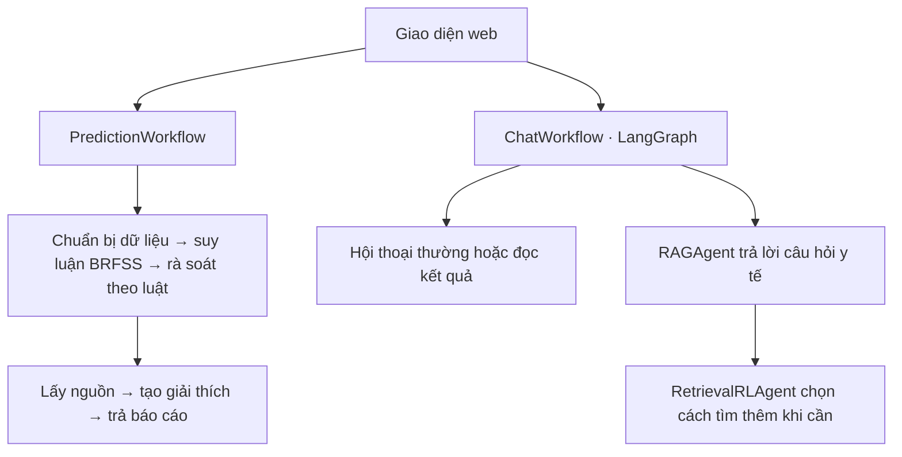

# Diabet · Hệ thống dự đoán có giải thích

Đồ án hỗ trợ quyết định về tiểu đường. Người dùng nhập chỉ số, xem điểm, lưu ý từ luật và tài liệu tham khảo, rồi có thể hỏi tiếp. RL điều phối truy xuất bổ sung của chatbot.

## Cấu trúc thư mục

| Thư mục | Nội dung |
| --- | --- |
| `web/` | Giao diện một trang, với JavaScript và CSS trong `web/assets/`. |
| `src/api.py` | API FastAPI và các endpoint phục vụ giao diện. |
| `src/workflows/` | Luồng dự đoán, điều phối chat bằng LangGraph, rà soát theo luật và ghi vết. |
| `src/agents/` | Agent hỏi đáp RAG, chính sách truy xuất RL và lớp Q-learning dùng khi huấn luyện. |
| `src/evaluation/` | Bộ câu hỏi kiểm thử, đo độ phủ KB và huấn luyện chính sách RL. |
| `src/models/` | Kiểm tra đầu vào, nạp pipeline và chạy suy luận BRFSS. |
| `src/graph/` | Mã nạp tài liệu, tạo chỉ mục và truy xuất Neo4j. |
| `database/neo4j/` | Cypher để xây dựng và kiểm tra các quan hệ có dẫn chứng. |
| `data/kb/` | Danh mục nguồn, ghi chú PDF đã rà soát và tài liệu BRFSS của dự án. |
| `src/storage/` | Ngữ cảnh dự đoán trong RAM và lưu hội thoại MySQL. |
| `models/` | Mô hình BRFSS `brfss_web5.bin` và Q-table `rag_policy.json`. |
| `notebooks/` | Notebook huấn luyện, đánh giá và xuất model BRFSS. Bản đang dùng là `train_brfss_web5.ipynb`. |
| `docs/` | Sơ đồ luồng dự đoán và chat. |
| `artifacts/` | Cache tải nguồn, mô hình embedding local, audit và kết quả chạy. Báo cáo cũ và bản tải đối chiếu nằm trong `artifacts/archive/`. |
| `neo4j/` | Dữ liệu và log Neo4j cục bộ. |

## Chạy trên Windows PowerShell

```powershell
# Chỉ sao chép cấu hình mẫu nếu chưa có .env
if (-not (Test-Path .env)) { Copy-Item .env.example .env }
if (-not (Test-Path .venv\Scripts\python.exe)) { python -m venv .venv }
.\.venv\Scripts\python.exe -m pip install -r requirements.txt
.\.venv\Scripts\python.exe -m uvicorn src.api:app --reload
```

Mở giao diện tại <http://127.0.0.1:8000>, tài liệu API ở <http://127.0.0.1:8000/docs> và trạng thái dịch vụ ở <http://127.0.0.1:8000/health>. Neo4j Browser chạy tại <http://localhost:7474>.

API dự đoán chạy trên CPU với model đã huấn luyện. Thiết lập `MODEL_PATH=models/brfss_web5.bin` nếu chuyển từ cấu hình cũ. Khởi động lại API sau khi thay file model để nạp phiên bản mới. Để bổ sung nguồn tham khảo và chạy hỏi đáp, khởi động Neo4j rồi nạp dữ liệu nếu cơ sở dữ liệu còn trống.

```powershell
docker compose --env-file .env up -d
.\.venv\Scripts\python.exe -m src.graph.ingest
.\.venv\Scripts\python.exe -m src.graph.index_rag --download-models
.\.venv\Scripts\python.exe -m src.graph.kg
```

## Luồng dự đoán và hỏi tiếp



1. `POST /predict` kiểm tra các trường đầu vào, chạy mô hình và trả báo cáo cùng `prediction_id`.
2. `POST /predictions/{prediction_id}/questions` nhận câu hỏi và tối đa tám tin nhắn gần nhất. API truy xuất chỉ số đã nhập và kết quả theo mã dự đoán, sau đó dùng Neo4j và LLM để giải thích theo ngữ cảnh.
3. Khung chat dùng `/rag/ask`. LangGraph phân loại tin nhắn thành hội thoại thông thường, câu hỏi y tế hoặc yêu cầu đọc kết quả trong ứng dụng. Nhánh y tế gọi RAG Agent trên kho kiến thức về tiểu đường. Nhánh đọc kết quả dùng lượt dự đoán đã gửi gần nhất, hoặc hướng dẫn bấm **Xem kết quả** nếu chưa có lượt tính.
4. Web lưu mã phiên chat và gửi lại ở các lượt sau. Backend giữ toàn bộ lượt trao đổi của phiên trong RAM để hiểu câu hỏi nối tiếp. Phiên hết hạn sau một giờ không hoạt động, có giới hạn 64.000 ký tự lịch sử trước lượt kế tiếp và chạy theo một tiến trình. Nút **Cuộc trò chuyện mới** bắt đầu phiên chat riêng. Khởi động lại API hoặc tải lại trang cần bắt đầu phiên mới.

### Các bước của luồng dự đoán

| Bước | Đầu vào và đầu ra |
| --- | --- |
| Chuẩn bị dữ liệu | Kiểm tra năm trường BRFSS và chuyển sang định dạng đầu vào của mô hình. |
| Suy luận BRFSS | Tính điểm MLP và kiểm tra điểm hợp lệ. |
| Rà soát theo luật | Gắn cờ BMI ngoài khoảng quan sát khi huấn luyện hoặc điểm gần ngưỡng nội bộ. |
| Lấy tài liệu tham khảo | Truy xuất Neo4j bằng câu hỏi chung của báo cáo. Lỗi bước này vẫn cho phép trả điểm. |
| Tạo giải thích và báo cáo | Ghép mô tả theo mẫu rồi trả điểm, cờ, nguồn và `workflow_trace`. |
| Ghi nhật ký | Ghi metadata thực thi vào `artifacts/audit/prediction.jsonl`. |

Trong báo cáo dự đoán, mở **Các bước xử lý dự đoán** để xem từng bước. Dùng mã `request_id` hoặc header `X-Request-ID` để đối chiếu log, kể cả đối với yêu cầu sai dữ liệu.

### RL điều phối truy xuất chatbot

Sau lượt Hybrid RAG đầu, agent chỉ can thiệp nếu KB chưa trả được đoạn phù hợp hoặc còn thiếu một phần câu hỏi. Trạng thái ghi có đoạn, có phần thiếu, có đối tượng riêng và các hành động đã thử. Q-learning chọn mở rộng từ đồng nghĩa, mở rộng Neo4j hoặc dừng. Mỗi cách tìm thêm được thử tối đa một lần và dùng chung bộ lọc phạm vi với truy xuất ban đầu.

Huấn luyện offline bằng các lượt truy xuất được phát lại trên KB hiện có. Phần thưởng dựa trên nguồn hoặc trang chuẩn của câu hỏi và trừ chi phí tìm thêm. Khi chạy web, hệ thống đọc Q-table đã huấn luyện từ `models/rag_policy.json`. Trạng thái chưa gặp dùng luật dự phòng. Nhật ký quyết định được trả trong phản hồi chat và hiển thị ở **Các bước tìm bằng chứng** khi có quyết định bổ sung.

```powershell
.\.venv\Scripts\python.exe -m src.evaluation.train_retrieval_policy
```

Báo cáo so sánh với luật cố định được lưu ở `artifacts/rag_rl_evaluation.json`. Khởi động lại API để nạp Q-table mới.

Cấu hình `GEMINI_API_KEY` hoặc `NVIDIA_API_KEY` trong `.env` để bật trả lời hội thoại tự do. Có thể chọn model bằng `RAG_MODEL` và `NVIDIA_MODEL`. Gemini là dịch vụ chính khi có key. Với lỗi quota hoặc quá tải được hỗ trợ, có thể chuyển sang NVIDIA. Nhà cung cấp nhận câu hỏi, lịch sử phiên và các đoạn KB nếu câu hỏi thuộc phạm vi tiểu đường. Các nguồn được trích dẫn trong câu trả lời xuất hiện dưới tin nhắn. Hỏi điểm của lượt dự đoán được xử lý trong ứng dụng. Chỉ dùng dữ liệu mẫu hoặc đã khử định danh.

Các endpoint `/rag/ask` và `/chat/conversations` cũ vẫn có thể gọi qua API. Lịch sử MySQL phục vụ các endpoint chat cũ. Giao diện kết quả mới dùng ngữ cảnh ngắn hạn, nên có thể chạy mà không cần MySQL.

## Mô hình và kho kiến thức

Mô hình đang chạy là MLP huấn luyện trên [BRFSS 2015](https://www.kaggle.com/datasets/alexteboul/diabetes-health-indicators-dataset) với 5 thuộc tính. File Joblib chứa bộ chuẩn hóa, mạng neuron và ngưỡng dùng để đánh giá trong notebook. API dùng ngưỡng nội bộ 0,5, còn giao diện hiển thị điểm mô hình theo phần trăm. Dự án dùng scikit-learn 1.6.1 để khớp với phiên bản tạo file.

`POST /predict` nhận đủ 5 trường. `Age` là mã nhóm tuổi từ 1 (18–24 tuổi) đến 13 (80 tuổi trở lên). `GenHlth` là sức khỏe tự đánh giá từ 1 (xuất sắc) đến 5 (kém). `BMI` tính bằng kg/m². `HighBP` và `HighChol` dùng 0 = Không và 1 = Có.

```json
{"Age":7,"BMI":28,"HighBP":1,"HighChol":0,"GenHlth":3}
```

Điểm mô hình phục vụ học tập. Nó không biểu thị xác suất mắc bệnh thực tế và không dùng để chẩn đoán hay kê đơn.

## Truy xuất RAG trong Neo4j

KB lưu trong `neo4j/data/`. Phần truy xuất dùng full-text, embedding multilingual E5-small và các quan hệ `RAG_MENTIONS`. Kết quả được gộp bằng RRF, lọc theo đối tượng và xếp lại bằng cross-encoder mMARCO MiniLM. Nếu thiếu bằng chứng, hệ thống tìm lại tối đa một lần bằng thuật ngữ chuẩn, rồi báo rõ phần còn thiếu. Embedding và rerank chạy local bằng ONNX Runtime trên CPU. Các câu hỏi về điểm mô hình BRFSS dùng thông tin của ứng dụng và phiên dự đoán.

### Nguồn và quy trình nạp KB

[Danh mục nguồn](data/kb/sources.json) khai báo từng URL được phép tải, tổ chức, ngôn ngữ và phạm vi. Bản hiện tại gồm các bài CDC và NIDDK, hai PDF hướng dẫn của Bộ Y tế, tài liệu BRFSS do nhóm viết và bốn bài Vinmec đã có trong Neo4j.

- `ingest --fetch-only` tải các URL đã duyệt vào `artifacts/kb_sources/` và chưa ghi Neo4j. Mặc định tái sử dụng bản đã tải. Dùng `--refresh` khi cần lấy lại nguồn.
- `ingest --offline` tách HTML theo mục, giữ bảng cùng dòng tiêu đề và nạp các trang PDF đã chọn. Mỗi đoạn giữ URL, tiêu đề mục và vị trí trong PDF. Thêm `--dry-run` để xem số đoạn trước khi ghi.
- QĐ 1470 là bản scan. [Tệp ghi chú theo trang](data/kb/moh_1470_notes.json) chứa phần tóm lược đã đối chiếu cho các trang PDF 14, 15 và 30. Mã SHA-256 bảo đảm ghi chú được gắn đúng bản PDF. Số trang dẫn tới vị trí trong tệp, kể cả khi số in trên văn bản khác.
- `index_rag` dùng các đoạn đã có trong Neo4j, gắn chủ đề Việt–Anh và tạo lại dữ liệu truy xuất. `--download-models` chỉ cần ở lần đầu trên mỗi máy.

```powershell
.\.venv\Scripts\python.exe -m src.graph.ingest --fetch-only
.\.venv\Scripts\python.exe -m src.graph.ingest --offline
.\.venv\Scripts\python.exe -m src.graph.index_rag --download-models
.\.venv\Scripts\python.exe -m src.graph.kg
.\.venv\Scripts\python.exe -X utf8 -m src.evaluation.evaluate_kb_coverage
```

Lệnh `evaluate_kb_coverage` đo khả năng tìm đúng nguồn trong top 5, gồm các câu kiểm tra số trang PDF. Bài kiểm thử chạy độc lập với LLM. Dùng `evaluate_rag` khi chạy bộ KB 4 bài cũ, vì bộ câu hỏi đó gắn nhãn thiếu nguồn cho một số chủ đề thai kỳ và CGM. Lệnh `src.graph.kg` chạy [script Cypher](database/neo4j/knowledge_graph.cypher) trên cơ sở dữ liệu đang cấu hình. Mở [inspect.cypher](database/neo4j/inspect.cypher) trong Neo4j Browser để xem quan hệ và trang PDF làm bằng chứng.
